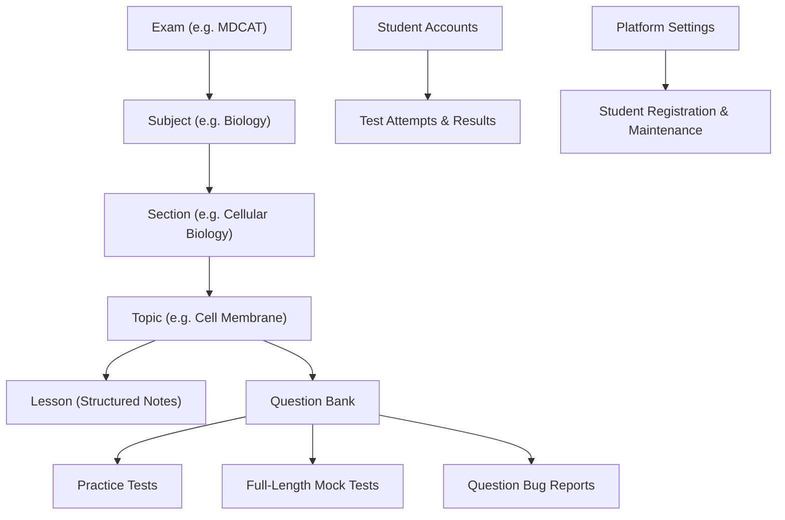

# PakSeekers — Admin Module Audit & Implementation Plan

**Role:** Senior Software Architect, Full-Stack Engineer, Database Engineer & QA Specialist  
**Platform:** PakSeekers  
**Target Environment:** Next.js 16 App Router (Turbopack) & MongoDB Atlas  
**Architecture:** Modular Monolith + Domain-Driven Design (DDD) + Repository Pattern  
**Date:** November 18, 2026  

---

## 1. Executive Summary & Audit Findings

The PakSeekers application has a robust foundation with functional **Exams**, **Subjects**, **Topics**, **Questions**, **Tests**, **Quiz Importer**, and **Student Dashboard/Attempt** features.

However, all 7 auxiliary admin navigation modules currently render static placeholder pages (`src/app/admin/_components/placeholder-page.tsx`) without database persistence or backend server actions:
1. **Sections** (`/admin/sections`) — Placeholder
2. **Lessons** (`/admin/lessons`) — Placeholder
3. **Mock Tests** (`/admin/mock-tests`) — Placeholder
4. **Students** (`/admin/students`) — Placeholder
5. **Reports** (`/admin/reports`) — Placeholder
6. **Question Reports** (`/admin/question-reports`) — Placeholder
7. **Settings** (`/admin/settings`) — Placeholder

This document establishes the initial audit findings, domain entity models, database collection schemas, authorization rules, and execution plan to make every module 100% functional, connected to MongoDB Atlas, and integrated with the student-facing platform.

---

## 2. Module-by-Module Audit & Integration Mapping

### Module A: Sections Management (`/admin/sections`)
* **Current State:** Static placeholder page (`src/app/admin/sections/page.tsx`). No backend model or repository.
* **Domain Placement:** A Section groups related Topics and Lessons within an Exam and Subject (e.g., MDCAT Biology -> "Cellular Biology", "Genetics & Biotechnology", "Human Physiology").
* **Database Support:** New collection `sections` with unique index on `id` and compound index on `{ examId: 1, subjectId: 1, order: 1 }`.
* **Referential Integrity:** Deletion guarded if associated topics or lessons exist.
* **Student Integration:** Display sections on Subject detail pages (`/exams/[examId]/subjects/[subjectId]`) to structure the curriculum.

### Module B: Lessons Management (`/admin/lessons`)
* **Current State:** Static placeholder page (`src/app/admin/lessons/page.tsx`).
* **Domain Placement:** Structured learning material, key formulas, conceptual explanations, and learning objectives mapped to Topic, Subject, and Exam.
* **Content Format:** Clean educational Markdown with LaTeX formula support, estimated reading time, and bulleted learning objectives.
* **Database Support:** New collection `lessons` with indexes on `{ examId: 1, subjectId: 1, topicId: 1 }`, `{ status: 1 }`.
* **Student Integration:** Accessible to students at `/lessons/[id]` or within Topic views. Draft/unpublished lessons return 404 for students while admins can preview them at `/admin/lessons/[id]/preview`.

### Module C: Mock Tests Management (`/admin/mock-tests`)
* **Current State:** Static placeholder page (`src/app/admin/mock-tests/page.tsx`).
* **Domain Placement:** Reuses the existing `Test` domain entity and question bank infrastructure by introducing `testType: "practice" | "mock"`, `totalMarks`, `passingMarks`, and `negativeMarking` properties.
* **Zero Duplication:** Avoids creating a duplicate quiz engine. Mock tests run on the exact same `QuizEngine` ([`src/features/practice/components/quiz-engine.tsx`](file:///c:/Users/mudas/OneDrive/Desktop/6th/pakseekers/pakseekers-v1/src/features/practice/components/quiz-engine.tsx)) and evaluate on the same server action.
* **Student Integration:** Highlighted in the student dashboard (`/student/tests`) under a "Full-Length Mock Exams" section with negative marking rules and simulation timers.

### Module D: Students / User Management (`/admin/students`)
* **Current State:** Static placeholder page (`src/app/admin/students/page.tsx`).
* **Domain Placement:** Queries the existing `users` collection filtered by `role: "student"`. Adds `status: "active" | "suspended"` to `UserDoc`.
* **Security & Sanitization:** Passwords and `passwordHash` are strictly stripped from all presentation data. Admins can view profile, target exam, institution, test attempt history, average scores, and toggle activation/suspension.
* **Enforcement:** Suspended accounts are immediately blocked from logging in or taking tests via `requireStudent()`.

### Module E: Reports & Analytics (`/admin/reports`)
* **Current State:** Static placeholder page (`src/app/admin/reports/page.tsx`).
* **Real MongoDB Aggregations:** Eliminates placeholder or fabricated data:
  1. *Platform Stats:* Total students, active students, exams, subjects, questions, published tests, attempts.
  2. *Performance Metrics:* Global average score, highest score, pass rate, completion rate.
  3. *Content Distribution:* Questions grouped by subject and exam via MongoDB `$group`.
  4. *Attempt Trends:* Most attempted tests and recent activity.
  5. *CSV Export:* Clean data export functionality for offline analysis.

### Module F: Question Reports Management (`/admin/question-reports`)
* **Current State:** Static placeholder page (`src/app/admin/question-reports/page.tsx`). No student reporting mechanism.
* **Domain Placement:** New collection `question_reports` linking `questionId`, `studentId`, `reason` ("wrong_answer", "typo", "unclear_explanation", "out_of_syllabus", "other"), description, and admin resolution status.
* **Student Integration:** "Report Issue" button and modal on `QuestionCard` in quiz practice.
* **Admin Workflow:** Review submitted reports, update status (Pending -> Under Review -> Resolved / Rejected), record admin resolution notes, and deep-link directly to `/admin/questions/[id]/edit` for instant correction.

### Module G: Settings Management (`/admin/settings`)
* **Current State:** Static placeholder page (`src/app/admin/settings/page.tsx`).
* **Domain Placement:** New collection `platform_settings` storing general info, platform registration toggles, maintenance mode, and exam default preferences.
* **Security Guarantees:** Database connection strings and authentication secrets are never exposed in UI or database settings. Displays a read-only environment and security configuration health check.
* **System Integration:** Registration toggle directly enforced in `registerStudentAction`.

---

## 3. Database Schema Extensions

### New Collections in MongoDB Atlas:
1. `sections`: `{ id, title, description, examId, subjectId, order, status, createdAt, updatedAt }`
2. `lessons`: `{ id, title, slug, description, content, examId, subjectId, topicId, sectionId, learningObjectives, order, readTimeMinutes, status, createdAt, updatedAt }`
3. `question_reports`: `{ id, questionId, questionText, studentId, studentName, studentEmail, reason, description, status, adminNotes, resolvedBy, resolvedAt, createdAt, updatedAt }`
4. `platform_settings`: `{ id: "default", general, platform, examination, content, updatedAt, updatedBy }`

### Modified Existing Collections:
* `users`: Added `status?: "active" | "suspended"`, `lastLoginAt?: string`.
* `tests`: Added `testType?: "practice" | "mock"`, `totalMarks?: number`, `passingMarks?: number`, `negativeMarking?: number`, `instructions?: string`.

---

## 4. Phased Implementation Roadmap

1. **Phase A — Domain Types & Database Foundation:** Update `content.ts`, `auth.ts`, and `src/server/db/schema.ts` with new interfaces, collection names, and automated index creation.
2. **Phase B — Repository & Service Layer:** Implement CRUD operations in `content-repository.ts`, `user-repository.ts`, and create `reports-service.ts` and `settings-service.ts`.
3. **Phase C — Server Actions & Authorization:** Create validated server actions for sections, lessons, mock tests, student status, question reports, and platform settings.
4. **Phase D — Admin Presentation Layer:** Build functional views for all 7 modules with tables, search, filters, modals/forms, loading states, and delete confirm buttons.
5. **Phase E — Student-Facing Integrations:** Connect mock tests to student dashboard, add question reporting in quiz engine, and render subject lessons.
6. **Phase F — Automated Verification:** Develop and execute `scripts/test-admin-modules.mjs`, run `npm run lint`, `npx tsc --noEmit`, and `npm run build`.
