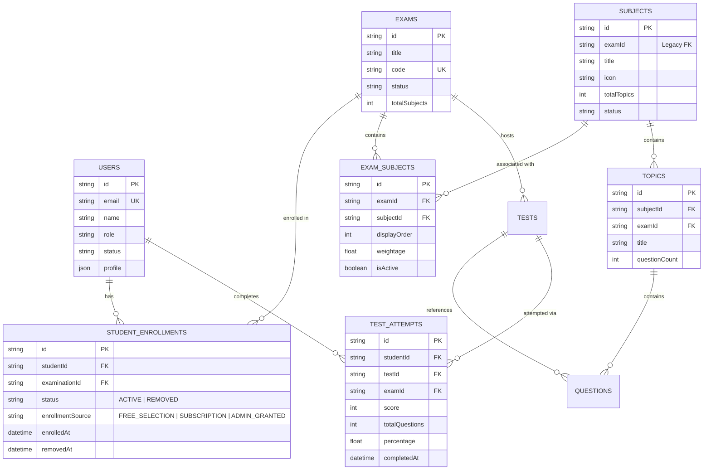
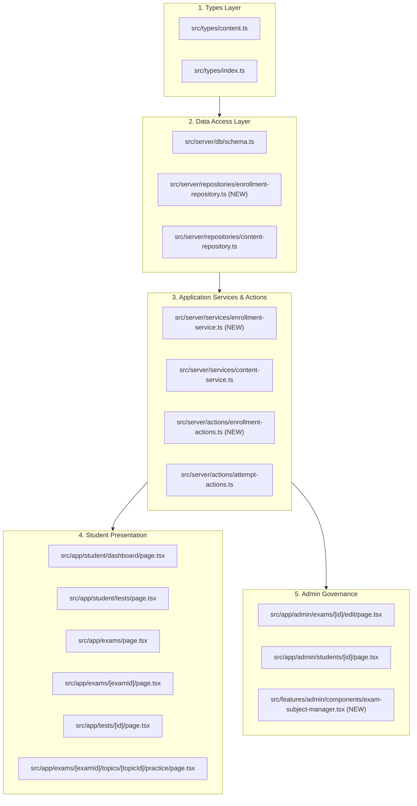

# Multi-Exam Enrollment & Content Access Architecture

**System**: PakSeekers Academic Preparation Platform  
**Document**: Architecture Specification & Technical Audit  
**Author**: Senior Software Engineer & System Architect  
**Status**: APPROVED FOR IMPLEMENTATION  
**Target Version**: PakSeekers v1.2.0  

---

## 1. Executive Summary & Objective

PakSeekers is transitioning from a single-exam or open-curriculum access paradigm into an enterprise-grade **Multi-Examination Preparation & Student Access Enforcement Engine**. Under this model:

1. **Multi-Track Academic Preparation**: A student account can concurrently prepare for multiple examinations (e.g., MDCAT, ECAT, FAST Entry Test, NUST NET) with full isolation between curricula.
2. **Permanent Free Enrollment**: In this release, student enrollment is permanent until manually removed. No automated expiry is applied. Re-enrollment is permitted at any time.
3. **Data Immutability & Historical Integrity**: Removing an examination revokes access to the exam workspace and future assessments, but strictly preserves all historical test attempts, scores, and analytics.
4. **Normalized Many-to-Many Exam-Subject Relationship**: Subjects (e.g., Physics, Chemistry, English) are reusable across different examinations with exam-specific sequence ordering (`displayOrder`) and optional weightage (`weightage`), eliminating duplicated content records while preserving backward compatibility.
5. **Strict Server-Side Access Enforcement**: Access control is executed authoritatively at the Server Action and Service layer (`canAccessExamination(studentId, examId)`). Client-side UI hiding is strictly treated as presentation, not security.
6. **Extensible Monolith Architecture**: Designed to seamlessly accept future monetization models (`FREE_SELECTION`, `SUBSCRIPTION`, `ADMIN_GRANTED`) without database refactoring or breaking existing schemas.

---

## 2. Current State vs. Target State Analysis

| Dimension | Current State (v1.1) | Target State (v1.2 Multi-Exam) |
| :--- | :--- | :--- |
| **Student Enrollment Model** | Implicit, 1:1 via `user.profile.targetExam` string field; no explicit enrollment collection. | Explicit Many-to-Many via `student_enrollments` collection (`studentId`, `examinationId`, `status`, `enrollmentSource`). |
| **Exam-Subject Relationship** | 1:Many hardcoded via `SubjectDoc.examId: string`. Duplicated subjects required for shared disciplines. | Many-to-Many via `exam_subjects` junction collection (`examId`, `subjectId`, `displayOrder`, `weightage`). Subjects reusable. |
| **Content Access Enforcement** | Open access; student dashboard loads all platform subjects and published tests indiscriminately. | Enforced at Data/Action layer via `canAccessExamination()`. Dashboard and tests scoped to active enrollments. |
| **Historical Data Retention** | N/A (no removal capability). | Removing an examination soft-updates enrollment status to `REMOVED`; historical attempts and results remain untouched. |
| **Student Workspace** | Generic `/student/dashboard` with unsegmented metrics. | Dedicated Exam Workspace per enrolled exam (`/student/exams/[examId]` / `/exams/[examId]`) + multi-exam switcher. |
| **Exam Catalog UX** | Static catalog linking to subject lists; no enrollment interaction. | Interactive catalog displaying "Enrolled", "Enroll Now" (one-click enrollment), and workspace shortcuts. |
| **Admin Governance** | Exam creation only; cannot manage shared subject associations or inspect student enrollments. | Admin can associate shared subjects with ordering, inspect all enrollments per student, and adjust status. |

---

## 3. Domain Models & Entity-Relationship Architecture

### 3.1 Domain Models Specification

#### A. Student Enrollment Entity (`StudentEnrollmentDoc`)
- **Collection**: `student_enrollments`
- **Fields**:
  - `id: string` (e.g., `enr_${studentId}_${examId}`)
  - `studentId: string` (Reference to `users.id`)
  - `examinationId: string` (Reference to `exams.id`)
  - `status: "ACTIVE" | "REMOVED"`
  - `enrollmentSource: "FREE_SELECTION" | "SUBSCRIPTION" | "ADMIN_GRANTED"`
  - `enrolledAt: string` (ISO 8601 timestamp)
  - `removedAt?: string | null` (ISO 8601 timestamp)
  - `createdAt: string`
  - `updatedAt: string`

#### B. Exam-Subject Junction Entity (`ExamSubjectDoc`)
- **Collection**: `exam_subjects`
- **Fields**:
  - `id: string` (e.g., `es_${examId}_${subjectId}`)
  - `examId: string` (Reference to `exams.id`)
  - `subjectId: string` (Reference to `subjects.id`)
  - `displayOrder: number` (Sequence order in syllabus, 1-indexed)
  - `weightage?: number` (Optional percentage or mark weight in this exam)
  - `isActive: boolean` (Default `true`)
  - `createdAt: string`
  - `updatedAt: string`

#### C. Subject Entity Enhancements (`SubjectDoc`)
- Preserves `examId: string` for legacy compatibility.
- Adds `examIds?: string[]` to support multi-exam queries at index speed.

---

### 3.2 Mermaid Entity-Relationship Diagram



---

## 4. Access Control Matrix & Security Architecture

### 4.1 Role × Enrollment Status × Resource Matrix

| Resource / Action | Anonymous Guest | Student (No Enrollment) | Student (ACTIVE Enrollment) | Student (REMOVED Enrollment) | Admin |
| :--- | :--- | :--- | :--- | :--- | :--- |
| **Public Exam Catalog** (`/exams`) | Allowed | Allowed | Allowed | Allowed | Allowed |
| **Exam Overview Preview** (`/exams/[id]`) | Preview Only | Preview + Enroll CTA | Full Workspace Access | Preview + Re-enroll CTA | Full Admin Access |
| **Exam Subjects & Topics** | Denied (Redirect) | Denied (Prompt) | Full Access | Denied (Prompt) | Full Access |
| **Test Overview Screen** (`/tests/[id]`) | Denied (Login) | Denied (Prompt) | Full Access | Denied (Prompt) | Full Access |
| **Interactive Quiz Canvas** (`/practice`) | Denied (Login) | Denied (403/Prompt) | Full Access | Denied (403/Prompt) | Full Access |
| **Record Test Attempt** (`recordTestAttemptAction`)| Denied (401) | Denied (403 Forbidden) | Allowed (200 OK) | Denied (403 Forbidden) | Allowed (Demo) |
| **Student Dashboard** (`/student/dashboard`) | Denied (Login) | Empty State + Enroll CTA| Scoped to Enrolled Exams| Historical Stats Preserved | Admin Dashboard |
| **Student Available Tests** (`/student/tests`) | Denied (Login) | Empty State | Filtered to Enrolled Exams | Excludes Removed Exam Tests | All Tests |
| **Enroll In Exam Action** | Denied (Login) | Allowed | Idempotent No-op | Re-enrolled to ACTIVE | Allowed |
| **Remove Exam Action** | Denied (Login) | Denied | Marked REMOVED | Idempotent No-op | Allowed |

### 4.2 Security Analysis & Attack Vector Mitigations

1. **Insecure Direct Object Reference (IDOR) on Test Attempt Submission**:
   - *Threat*: A student manipulates `examId` or `testId` payload in `recordTestAttemptAction()` to submit scores or harvest question explanations for an exam they are not enrolled in.
   - *Mitigation*: The action extracts the authentic session student ID via `getCurrentUser()` and executes `canAccessExamination(student.id, examId)` prior to retrieving questions or processing answers. Non-enrolled requests fail immediately with an authorization rejection.
2. **Direct URL Navigation to Test Canvas (`/exams/[examId]/topics/[topicId]/practice`)**:
   - *Threat*: Non-enrolled users bookmark or guess direct practice URLs to bypass the catalog paywall/enrollment gate.
   - *Mitigation*: The server component verifies `canAccessExamination()` before fetching questions or rendering `QuizEngine`. Non-enrolled students receive an enrollment modal or redirect with clear context.
3. **Data Pollution & Multi-Enrollment Race Conditions**:
   - *Threat*: Rapid clicking on "Enroll" causes duplicate active enrollment documents.
   - *Mitigation*: Enforce unique compound index on MongoDB Atlas `{ studentId: 1, examinationId: 1 }` and implement idempotent atomic upsert (`$set: { status: "ACTIVE", updatedAt: now }`) with transaction or check-then-set semantics.
4. **Historical Attempt Tampering upon Exam Removal**:
   - *Threat*: Removing an exam triggers cascading delete that destroys student attempt records or breaks analytic queries.
   - *Mitigation*: Soft-deletion pattern only. `removeStudentEnrollment` sets `status: "REMOVED"` and records `removedAt`. `COLLECTIONS.ATTEMPTS` is never modified or deleted during enrollment lifecycle changes.

---

## 5. Data Migration & Backward-Compatibility Strategy

> [!IMPORTANT]
> Zero-Downtime Non-Destructive Migration Principle: No existing database collections or fields will be dropped. Existing content relationships remain valid while new multi-exam capabilities are overlaid.

### 5.1 Backward Compatibility Invariants
1. **Existing Subjects**: Every existing subject currently possesses an `examId: string`. During migration and ongoing operations, this legacy field is retained. The new `exam_subjects` collection is populated as a superset.
2. **Subject Queries**: If an application query calls `getAllSubjects(examId)`, the system queries `exam_subjects` first. If no records exist (e.g., during transition), it seamlessly falls back to `{ examId }` on `subjects`.
3. **Existing Students**: Active students who registered prior to multi-exam enrollment may have a `user.profile.targetExam` value. An idempotent migration script (`scripts/reconcile-exam-subjects.mjs`) automatically provisions `ACTIVE` enrollment records for their declared target exam.
4. **Existing Tests & Attempts**: Every test and test attempt already embeds `examId`, `examTitle`, `subjectId`, and `subjectTitle`. They remain 100% valid with zero data transformations required.

---

## 6. Scalability & Query Pattern Optimization

### 6.1 Database Indexes Design

```typescript
// Collections & Indexes Specification
// 1. Student Enrollments
db.collection("student_enrollments").createIndex(
  { studentId: 1, examinationId: 1 },
  { unique: true, name: "idx_enrollments_student_exam_unique" }
);
db.collection("student_enrollments").createIndex(
  { studentId: 1, status: 1 },
  { name: "idx_enrollments_student_status" }
);
db.collection("student_enrollments").createIndex(
  { examinationId: 1, status: 1 },
  { name: "idx_enrollments_exam_status" }
);

// 2. Exam-Subject Junctions
db.collection("exam_subjects").createIndex(
  { examId: 1, subjectId: 1 },
  { unique: true, name: "idx_exam_subjects_exam_subject_unique" }
);
db.collection("exam_subjects").createIndex(
  { examId: 1, displayOrder: 1 },
  { name: "idx_exam_subjects_exam_order" }
);
db.collection("exam_subjects").createIndex(
  { subjectId: 1 },
  { name: "idx_exam_subjects_subject" }
);
```

### 6.2 Query Patterns & Caching
- **Fast Authorization Check**: `canAccessExamination(studentId, examId)` executes a targeted `findOne({ studentId, examinationId: examId, status: "ACTIVE" }, { projection: { _id: 1 } })` against a compound covered index, completing in under 2ms.
- **Student Dashboard Load**: Performs a single `$in` query against `student_enrollments` to fetch all active exam IDs, followed by indexed lookups for subjects and tests.

---

## 7. Affected Files & Structural Plan


