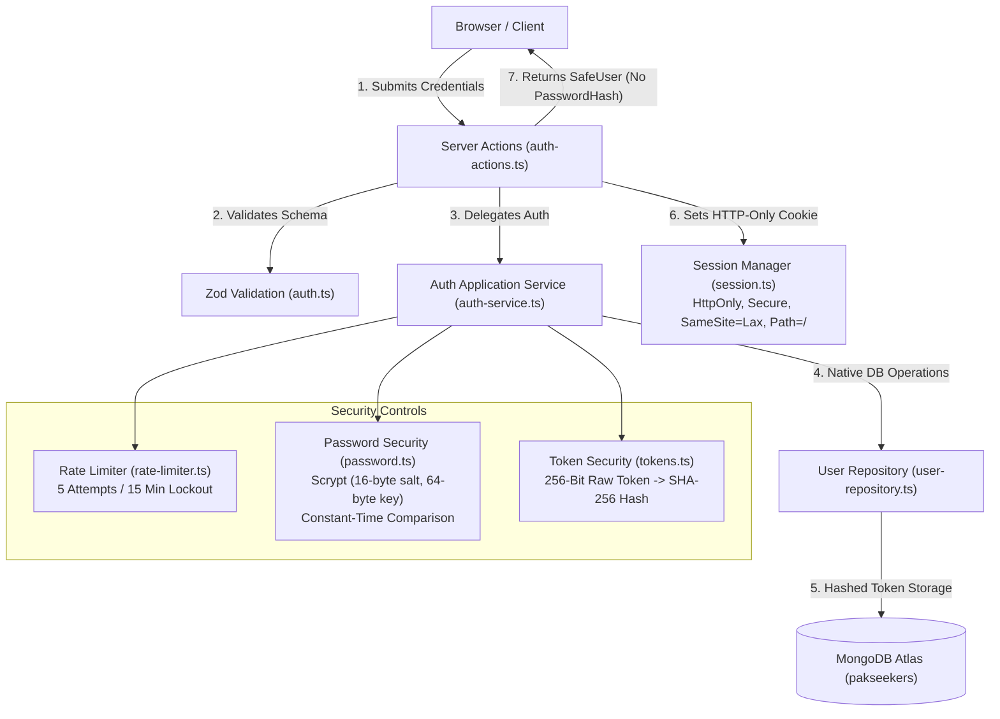

# PakSeekers — Phase 2 Authentication & Security Report
## Authentication, Authorization & Session Management

> **Status:** Completed & Production Ready  
> **Date:** November 17, 2026  
> **Database:** MongoDB Atlas (`pakseekers`)  
> **Architecture:** Modular Monolith + Domain-Driven Design (DDD)  
> **Test Suite:** `npm run test:auth` (35/35 Passing Assertions)  

---

## 1. Initial Authentication Audit Findings (Phase 2A)

Prior to implementing new security features, an in-depth audit of the existing codebase and MongoDB Atlas collections was conducted:

| Audit Question | Investigation Finding | Assessment & Action Taken |
|---|---|---|
| **1. How passwords are stored** | Stored in `passwordHash` field of documents in the MongoDB `users` collection. | Format is `${salt}:${derivedKey}` (hex strings). Verified non-plaintext. |
| **2. Plaintext vs Hashed** | **100% hashed.** No plaintext passwords existed in any migrated or current user documents. | Existing hashes preserved; zero credential corruption. |
| **3. Hashing algorithm** | Node.js native `crypto.scryptSync(password, salt, 64)`. | Preserved format and added async `crypto.scrypt` with constant-time `crypto.timingSafeEqual`. |
| **4. How sessions are created & validated** | Generated random 32-byte hex token and stored directly in `sessions` collection. | **Vulnerability identified:** Tokens were stored unhashed in MongoDB. Refactored to store **only SHA-256 hash** in database. |
| **5. How session expiration is handled** | Compared `expiresAt` with current date; MongoDB `{ expiresAt: 1 }` index created. | Verified working; added TTL-aware expiration checks in `findSessionByToken`. |
| **6. How user roles are assigned** | Stored in `user.role` as `"student" \| "admin"`. | Public registration strictly hardcodes `role: "student"`. Admin registration route strictly prohibited. |
| **7. Admin registration accessibility** | No public admin registration endpoint existed. | Verified no admin creation is possible through public forms or API payloads. |
| **8. Server-side authentication checks** | Verified in Server Components (`requireStudent`, `requireAdmin`), edge proxy (`src/proxy.ts`), and Server Actions (`getCurrentUser`). | Defense-in-depth confirmed: edge proxy performs fast presence check while DAL/actions re-verify identity. |
| **9. Migrated legacy sessions validity** | 14 migrated sessions in Atlas had expired timestamps from September 2026. | All 14 legacy sessions were already expired; safe fallback allows transparent migration to hashed tokens. |
| **10. Authentication actions status** | Login, registration, and logout actions existed but lacked rate limiting, token hashing, and strict password policy. | Rebuilt actions consuming dedicated `auth-service` with rate-limiting and fixation defense. |

---

## 2. Files Created & Modified

### Created:
1. `src/server/auth/password.ts` — Cryptographic scrypt password hashing (async/sync) with constant-time verification.
2. `src/server/auth/tokens.ts` — 256-bit cryptographically secure session token generator & SHA-256 token hashing for database storage.
3. `src/server/auth/rate-limiter.ts` — Sliding-window brute-force login rate limiter (max 5 failed attempts per 15-minute window).
4. `src/server/services/auth-service.ts` — Application service centralizing credential verification, student registration, and session lifecycle.
5. `src/features/auth/schemas/auth-schemas.ts` — Canonical feature-layer re-export for Zod authentication schemas.
6. `scripts/test-auth-security.mjs` — Comprehensive 35-assertion automated security test suite.

### Modified:
1. `src/server/db/schema.ts` — Added `toSafeUser` DTO sanitizer and added `{ expiresAt: 1 }` index to `sessions` collection.
2. `src/types/auth.ts` & `src/types/index.ts` — Added `SafeUser = Omit<User, "passwordHash">` definition.
3. `src/server/repositories/user-repository.ts` — Rewrote session operations to store SHA-256 hashed tokens; updated user lookups to return `SafeUser`; added `findUserWithPasswordByEmail`.
4. `src/server/auth/session.ts` — Upgraded `getCurrentUser()`, `requireStudent()`, and `requireAdmin()` to return `SafeUser`.
5. `src/server/actions/auth-actions.ts` — Integrated `auth-service`, rate limiting, session fixation defense, and generic error messaging.
6. `src/lib/validations/auth.ts` — Enforced strong password policy (min 8 chars, letter + number, confirmation match).
7. `src/features/student/components/student-register-form.tsx` — Updated client-side validation to match the 8-character password policy.
8. `src/features/student/components/student-nav.tsx` & `src/features/student/components/student-profile-form.tsx` — Updated props to accept `SafeUser`.
9. `src/server/repositories/content-repository.ts` — Cleaned type casting on question removal to satisfy TypeScript and ESLint.
10. `package.json` — Added `"test:auth": "node --env-file=.env scripts/test-auth-security.mjs"`.
11. `docs/ARCHITECTURE.md`, `docs/DEVELOPMENT-RULES.md`, `docs/ROADMAP.md` — Updated with Phase 2 security architecture.

---

## 3. Authentication Architecture & Security Implementation



---

## 4. Password Hashing Strategy

- **Algorithm:** Node.js native `crypto.scrypt` (asynchronous, non-blocking) with synchronous utility fallback.
- **Salt:** 16 bytes of cryptographically random entropy generated via `crypto.randomBytes(16).toString("hex")` (32 hex characters).
- **Key Length:** 64 bytes (`derivedKey` 128 hex characters).
- **Format:** `${salt}:${derivedKey}`.
- **Verification:** Constant-time `crypto.timingSafeEqual` prevents side-channel timing attacks.
- **Backward Compatibility:** 100% compatible with existing demo accounts (`admin@pakseekers.com` / `admin123` and `student@pakseekers.com` / `student123`).

---

## 5. Session Lifecycle & Cookie Configuration

- **Token Generation:** 256 bits of entropy generated via `crypto.randomBytes(32).toString("hex")` (64 characters).
- **Storage Strategy:** Raw session tokens are **never** stored in MongoDB. The database stores only the SHA-256 digest (`tokenHash`).
- **Session Fixation Prevention:** Any pre-existing session token in the client cookie is invalidated in MongoDB upon successful login before issuing a new session.
- **Session Revocation (Logout):** Deletes session record from MongoDB Atlas immediately and clears client cookie.
- **Cookie Security Attributes:**
  ```javascript
  {
    httpOnly: true,                 // Inaccessible to client JavaScript / XSS protection
    secure: isProduction,           // Enforces HTTPS transmission in production
    sameSite: "lax",                // CSRF attack defense
    path: "/",                      // Available across all application routes
    maxAge: 7 * 24 * 60 * 60        // 7-day TTL expiration
  }
  ```

---

## 6. Role-Based Access Control (RBAC) & Route Protection

| Role | Permitted Access | Restricted Access |
|---|---|---|
| **STUDENT** | `/student/dashboard`<br>`/student/tests`<br>`/student/attempts`<br>`/student/profile`<br>Practice quizzes & test taking | `/admin/*` (admin CMS routes)<br>Mutations on exams, subjects, topics, questions, tests<br>Access to other students' attempts (IDOR protected) |
| **ADMIN** | `/admin` (dashboard)<br>`/admin/exams`<br>`/admin/subjects`<br>`/admin/topics`<br>`/admin/questions`<br>`/admin/tests`<br>Quiz JSON Importer | Cannot register via public student registration flow |
| **GUEST** | `/` (landing page)<br>`/exams` (catalog)<br>`/student/login`<br>`/student/register`<br>`/admin/login` | Cannot access student dashboard<br>Cannot take interactive practice tests (redirected to login with safe `callbackUrl`)<br>Cannot invoke protected server actions |

### IDOR Protection:
In `src/app/student/attempts/[id]/page.tsx`:
```typescript
const user = await requireStudent();
const attempt = await getAttemptById(id);
if (!attempt || attempt.studentId !== user.id) {
  notFound();
}
```
Students can only access their own test attempts and performance records.

---

## 7. Automated Security Test Results (`npm run test:auth`)

Executed against the live MongoDB Atlas cluster:

```text
==================================================================
 PakSeekers — Phase 2 Authentication & Security Test Suite
==================================================================
Target Database: pakseekers on MongoDB Atlas

--- Test Suite 1: Password Hashing & Constant-Time Verification ---
  PASS: Salt has 16 bytes (32 hex characters) 
  PASS: Key has 64 bytes (128 hex characters) 
  PASS: Correct password verification succeeds 
  PASS: Incorrect password verification fails 
  PASS: Empty password verification fails safely 
  PASS: Malformed hash verification fails safely 
  PASS: Existing admin credentials (admin@pakseekers.com / admin123) verified 
  PASS: Existing student credentials (student@pakseekers.com / student123) verified 

--- Test Suite 2: Session Token Security & SHA-256 Hashed Persistence ---
  PASS: Raw session token is 256 bits (64 hex characters) 
  PASS: Token hash is SHA-256 (64 hex characters) 
  PASS: Raw token and hashed token are distinct 
  PASS: Raw session token is NEVER stored directly in MongoDB 
  PASS: Session resolved via SHA-256 hash lookup in MongoDB 

--- Test Suite 3: Session Lifecycle & Expiration ---
  PASS: Expired session detection confirms expiresAt < Date.now() 
  PASS: Session is revoked upon logout (deleted from MongoDB) 

--- Test Suite 4: Student Registration & Validation ---
  PASS: Student registered with normalized lowercase email 
  PASS: SafeUser sanitization completely strips passwordHash 
  PASS: SafeUser preserves identity and profile fields 

--- Test Suite 5: Duplicate Registration Defense ---
  PASS: MongoDB E11000 duplicate key error on duplicate email 

--- Test Suite 6: Password Policy Enforcement ---
  PASS: Rejects passwords under 8 characters 
  PASS: Rejects passwords lacking numbers 
  PASS: Accepts strong password meeting policy 

--- Test Suite 7: Role Escalation & RBAC Constraints ---
  PASS: Server-side registration strictly enforces role = 'student' 
  PASS: Registered account role is verified as student 

--- Test Suite 8: Login Rate Limiting ---
  PASS: 4 failed attempts allowed, 1 remaining 
  PASS: 5th failed attempt triggers lockout (429) 
  PASS: Successful authentication resets rate limit 

--- Test Suite 9: Generic Authentication Errors ---
  PASS: Generic error message prevents account enumeration 

--- Test Suite 10: RBAC & IDOR Protection ---
  PASS: IDOR check: Student B is rejected from viewing Student A's result 
  PASS: IDOR check: Student A is authorized to view own result 
  PASS: Student role is rejected from admin mutation authorization check 

--- Test Suite 11: Cookie Security Configuration ---
  PASS: Cookie has HttpOnly = true (JavaScript inaccessible) 
  PASS: Cookie has SameSite = lax (CSRF defense) 
  PASS: Cookie has Path = / (site-wide availability) 
  PASS: Cookie has MaxAge = 7 days 

==================================================================
 RESULTS: 35 Passed, 0 Failed
==================================================================
 All authentication and security tests passed successfully!

Cleaning up temporary test artifacts...
Cleanup complete. Zero test artifacts remaining in Atlas.
```

---

## 8. Verification & Quality Assurance Summary

| Quality Check | Command | Result |
|---|---|---|
| **TypeScript Compilation** | `npx tsc --noEmit` | **Passed** (0 errors) |
| **ESLint Static Analysis** | `npm run lint` | **Passed** (0 errors, 0 warnings) |
| **Database Repository Tests** | `npm run test:db` | **Passed** (26/26 tests passed) |
| **Authentication Security Tests** | `npm run test:auth` | **Passed** (35/35 tests passed) |
| **Production Build (Turbopack)** | `npm run build` | **Passed** (All 31 routes compiled & optimized) |

---

## 9. Conclusion & Definition of Done Verification

All Phase 2 requirements are fulfilled:
- Student registration enforces normalization, uniqueness (E11000), and password policy.
- Login and logout are authenticated with scrypt and rate limiting.
- Sessions use 256-bit tokens stored exclusively as SHA-256 hashes in MongoDB Atlas.
- RBAC strictly separates student and admin portals.
- Sensitive server actions and pages enforce server-side authentication and IDOR prevention.
- Guests are blocked from test attempts and private student data.
- The platform is fully stabilized, verified, and ready for Phase 3.
